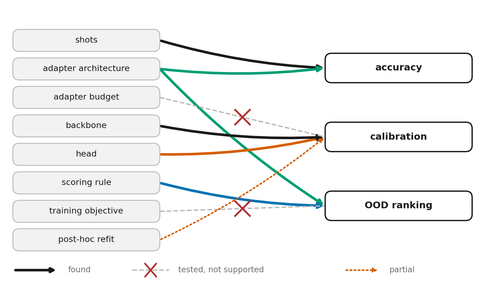
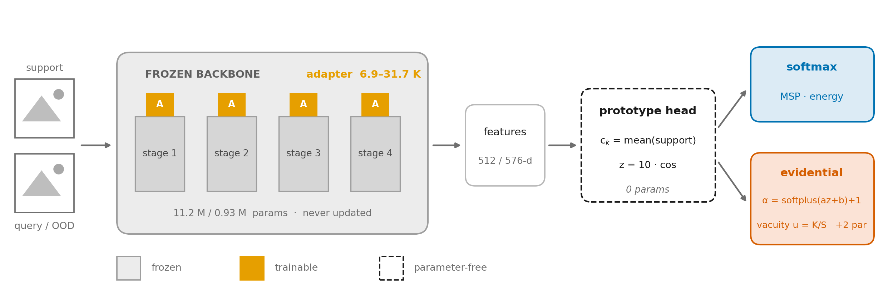
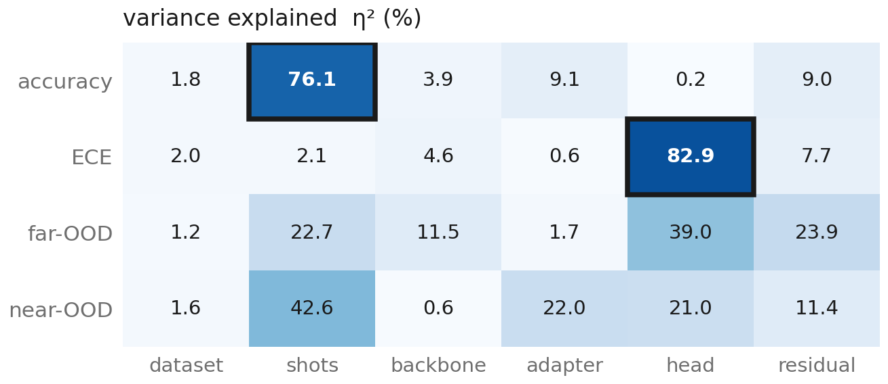
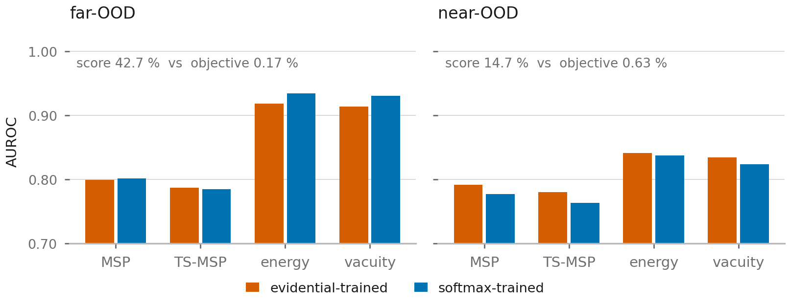
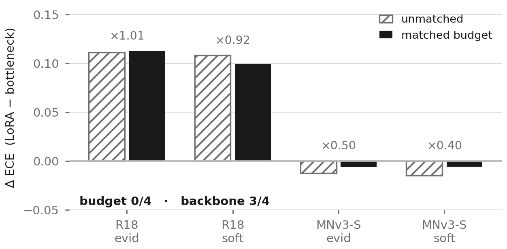
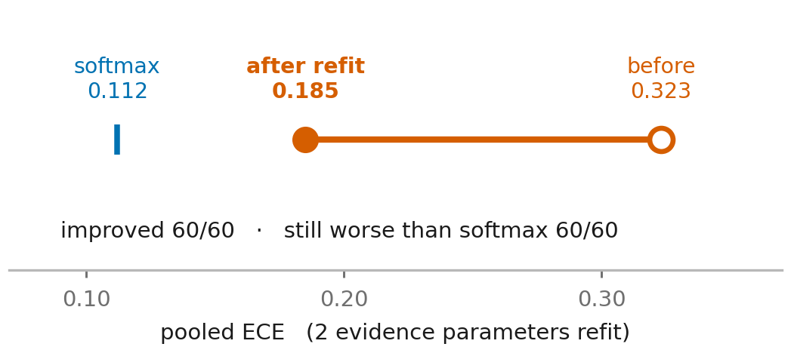

# Reliability in Few-Shot Classification with Frozen CNN Adapters: A Controlled Study

**B.Sc. thesis, Department of Computer Science and Engineering, Islamic University of Technology (IUT), September 2026**

**Authors:** Hamim Saad Al Raji (210042143) · MD Mainul Hasan (210042173) · Ahmed Sadman Labib (210042135)<br>
**Supervisor:** Shahriar Ivan, Assistant Professor, CSE, IUT · **Co-supervisor:** Md. Bakhtiar Hasan, Assistant Professor, CSE, IUT

📄 **Full thesis:** [`docs/thesis_report/main.pdf`](docs/thesis_report/main.pdf) · Project codename in the code: **B-PEFT**

---

## TL;DR

Parameter-efficient fine-tuning (PEFT) is almost always judged by accuracy alone. On a small device that
must learn new classes from **one or five images**, that is not enough. The model's confidence has to mean
something (**calibration**), and it has to notice images from classes it was never taught
(**out-of-distribution, OOD, detection**).

This thesis does not propose yet another method. It asks a different question: **which design choice
controls which of these three properties?** To answer it, we trained a balanced factorial grid of **120
models** plus **48 models in a pre-registered follow-up experiment**, all evaluated on the same 600 frozen
test episodes. The answer is a clean separation:

| Property | What controls it | Evidence |
|---|---|---|
| **Accuracy** | Shot count, then **adapter architecture** | Shots explain 76.1% of variance. The bottleneck adapter beats LoRA in 16/16 grid pairs and 8/8 matched-budget pairs |
| **Calibration** | **Head reading** (softmax vs. evidential), then the **backbone** | The head explains 82.9% of ECE variance but only 0.2% of accuracy. A pre-registered test rules out parameter budget (0/4 cells) |
| **OOD detection** | The **scoring rule**, not the training objective | The score explains 42.7% of far-OOD variance; the training objective explains 0.17% |

> No single design choice makes the model reliable on every axis. What the thesis offers is a **map of
> which choice controls which property**, together with the experiments that rule out the plausible
> alternatives.

<p align="center"></p>
<p align="center"><sub><b>Figure 1.</b> The findings in one picture. Solid arrows are effects we found. Crossed dashed arrows are
hypotheses we tested and rejected. The dotted arrow is a partial effect.</sub></p>

---

## 1. Motivation

Lightweight CNNs such as ResNet-18 and MobileNetV3-Small remain the practical choice for on-device vision.
Few-shot adaptation of these networks raises two problems.

1. **Efficiency.** Re-training millions of weights from 5–25 labelled images is wasteful and overfits.
   PEFT answers this by freezing the backbone and training a small add-on module.
2. **Reliability.** A model adapted from a handful of images will make mistakes. It is only usable if it
   *knows* when it is likely wrong and when an input belongs to no known class.

The literature has studied PEFT accuracy, few-shot calibration and evidential (Dirichlet) uncertainty, but
mostly one at a time and mostly on large transformers. We found no study that measures **all three
reliability properties together, under one protocol, across the design choices a practitioner actually
makes** for frozen lightweight CNNs. This thesis fills that gap.

---

## 2. Method

<p align="center"></p>
<p align="center"><sub><b>Figure 2.</b> The pipeline. Only the orange adapters (6.9K–31.7K parameters) are trained. The backbone
(11.2M / 0.93M parameters) is never updated, and the prototype head has no weights.</sub></p>

| Stage | Choice | Detail |
|---|---|---|
| **Backbone** (frozen) | ResNet-18 or MobileNetV3-Small | ImageNet-pretrained, BatchNorm statistics frozen, 512-d / 576-d features |
| **Adapter** (trainable) | Parallel bottleneck or LoRA | 6.9K–31.7K parameters, under 1% of the backbone's size |
| **Head** (parameter-free) | Prototype head | Class prototype = mean support feature; logit = 10 · cosine similarity |
| **Reading** | Softmax *or* evidential | Evidential: `α = softplus(a·z + b) + 1`, vacuity `u = K / Σα`, with 2 learnable parameters |
| **Training** | Episodic meta-training | 100 episodes/epoch, early stopping on 100 fixed validation episodes |
| **Baselines** | Full fine-tuning, linear probe | ResNet-18 on CIFAR-FS |

**Why a prototype head?** A linear classifier trained on the 64 training classes cannot transfer to the 20
disjoint test classes. A prototype head builds its classifier from each episode's support set, so it needs
no weights at all.

**Why two readings of the same logits?** The softmax and evidential readings share the backbone, adapter
and head. Only the interpretation of the logits differs. That isolates the effect of the evidential
(Bayesian-style) formulation from everything else.

---

## 3. Experimental design

### 3.1 The main grid: a balanced full factorial

| Factor | Level 1 | Level 2 |
|---|---|---|
| Dataset | CIFAR-FS | MiniImageNet |
| Shots | 1-shot | 5-shot |
| Backbone | ResNet-18 | MobileNetV3-Small |
| Adapter | Parallel bottleneck | LoRA |
| Head reading | Softmax | Evidential |

2⁵ = 32 settings, plus 8 baseline settings, gives 40 settings. Each is trained with 3 seeds, for **120
runs** (36.3 GPU-hours). All 120 completed with zero failures under a single fixed training recipe.

### 3.2 What we measure

| Property | Metrics |
|---|---|
| Accuracy | Top-1 accuracy with 95% CI, macro-F1 |
| Calibration | ECE (pooled, 15 bins), Brier score |
| OOD detection | AUROC and FPR@95 against **far-OOD** (SVHN, Gaussian noise) and **near-OOD** (held-out classes, TinyImageNet) pools |
| OOD scores | MSP, temperature-scaled MSP, energy, evidential vacuity |
| Cost | Trainable parameters, FLOPs, GPU/CPU latency, peak memory |

### 3.3 Protocol safeguards

- **Frozen evaluation.** 600 fixed test episodes (seeds 0–599) and 100 fixed validation episodes (seeds
  10000–10099). Episode files and class splits are frozen and never regenerated.
- **No test-set tuning.** Every hyperparameter, temperature and post-hoc refit is fitted on the validation
  episodes only.
- **Bit-exact reproducibility.** Deterministic seeding and cuDNN, and sorted-key JSON output. Re-running a
  configuration reproduces its `metrics.json` byte for byte.
- **Regression guards.** Every later analysis first re-scores saved models against the committed grid.
  Matches were 99/99, 18/18 and 21/21, all with a maximum absolute difference of 0.0.
- **Pre-registration.** The decision rule for the key experiment (RQ3) was written down and committed
  *before* the runs ([`docs/RQ3_MATCHED_BUDGET_PLAN.md`](docs/RQ3_MATCHED_BUDGET_PLAN.md)).

---

## 4. Research questions and findings

The thesis asks four **attribution** questions: *what drives what*, not *does method A beat method B*.

### RQ1 — How is variance in accuracy, calibration and OOD detection distributed across the design axes?

**Answer: shot count drives accuracy; the head reading drives calibration.**

<p align="center"></p>
<p align="center"><sub><b>Figure 3.</b> Share of variance (η²) explained by each factor over 96 balanced runs.</sub></p>

- The head reading explains **82.9%** of calibration variance but only **0.2%** of accuracy variance.
  Calibration and accuracy are governed by different design choices.
- Once the reading is fixed, calibration and OOD detection are nearly independent. The rank correlation
  falls from +0.43–0.48 overall to +0.15–0.26 within each reading.
- Adding two-way interactions shrinks the residual (accuracy 9.0% → 1.3%, ECE 7.7% → 2.1%). The
  `backbone × adapter` interaction is significant **only for calibration** (3.28%, 95% CI [2.52, 4.15],
  p < 10⁻⁶). This independently corroborates RQ3.

### RQ2 — Is OOD detection caused by the training objective or by the scoring rule?

**Answer: the scoring rule, decisively.**

In the original grid each model was scored only with "its own" score, so every comparison changed two
things at once. We therefore re-scored **every model with every score** under both training objectives, a
fully crossed 2 × 4 factorial with 120/120 coverage.

<p align="center"></p>
<p align="center"><sub><b>Figure 4.</b> Changing the score moves AUROC by about 0.13. Changing the training objective moves it by at
most about 0.02.</sub></p>

| OOD type | Variance explained by the score | Variance explained by the training objective |
|---|---:|---:|
| Far-OOD | **42.7%** | **0.17%** |
| Near-OOD | **14.7%** | **0.63%** |

- The parameter-free **energy** score works almost as well on evidential-trained models (AUROC 0.919) as on
  softmax-trained ones (0.934). We found no prior work that applies energy scoring to evidential models.
- Evidential **vacuity** beats softmax-probability scores (MSP, TS-MSP) in 37–38 of 40 settings on every
  pool. However, **energy beats vacuity in about 70%** of comparisons. The benefit attributed to evidential
  training actually comes from using a logit-space score.

### RQ3 — Does accuracy follow adapter architecture, and calibration follow parameter budget? *(strongest result)*

**Answer: accuracy follows architecture; calibration follows the *backbone*, not the budget.**

**Stage 1: a confound in the grid.** Across 16 matched bottleneck-vs-LoRA pairs, the bottleneck won
accuracy 16/16 and near-OOD 16/16, and the *larger* adapter always calibrated better. That looked like
"calibration follows budget". But the bottleneck is the larger adapter on ResNet-18 and the smaller one on
MobileNetV3-Small, so budget and backbone were confounded.

**Stage 2: a pre-registered matched-budget experiment.** We fixed the decision rule in advance, then built
both adapters at the **same parameter budget within each backbone** (mismatch ≤ 3.1%, compared with
55–158% in the grid). This gave 48 freshly trained runs on MiniImageNet 5-shot: 2 backbones × 2 budget
levels × 2 adapters × 2 readings × 3 seeds.

<p align="center"></p>
<p align="center"><sub><b>Figure 5.</b> The calibration gap between LoRA and the bottleneck, before (hatched) and after (solid)
equalising the parameter budget. On ResNet-18 the gap does not move.</sub></p>

- **Verdict `backbone_intrinsic`**: the budget hypothesis fired in **0 of 4** cells and the backbone
  hypothesis in **3 of 4**, meeting the pre-registered threshold.
- Equalising the budget leaves ResNet-18's gap **intact** (×1.01, ×0.92) and only halves
  MobileNetV3-Small's. The budget changes the gap's size; the backbone sets its direction.
- The architecture half holds: at matched budget the bottleneck still wins accuracy **8/8** and near-OOD
  **8/8**, all beyond 2σ.
- All 7 pre-registered acceptance criteria passed, and the 18 runs that repeat grid settings reproduce the
  grid exactly.
- **This verdict went against the hypothesis we favoured.** That is why we consider it the most
  trustworthy result in the thesis.

### RQ4 — Can the evidential head's calibration be fixed post hoc without breaking OOD ranking?

**Answer: largely yes. It improves everywhere, but does not catch up with softmax.**

We refit only the two evidence parameters `(a, b)` on validation episodes and re-evaluated on the 600 test
episodes.

<p align="center"></p>
<p align="center"><sub><b>Figure 6.</b> Mean ECE over all 60 evidential models before and after the 2-parameter refit, compared
with plain softmax.</sub></p>

| Result (60 evidential models) | Value |
|---|---|
| ECE improved | **60 / 60** models, mean 0.323 → 0.185 |
| OOD AUROC preserved (Δ ≥ −0.005) | **192 / 240** comparisons (80%), mean Δ +0.003 |
| Worst-case rank correlation of OOD scores | ρ = 0.866 |
| Still worse calibrated than plain softmax | **60 / 60** |

The refitted scales (median 8.3) are far from those learned in training (median 2.9). Joint training under
the evidential loss leaves the head far from its best calibration point. A two-parameter fix on validation
data cuts mean ECE by 43%.

### Hypotheses we tested and rejected

Several of our own expectations did not survive the data, and we report each one:

| Expected | What the evidence showed |
|---|---|
| The evidential head calibrates better than softmax | Worse in **20 / 20** matched pairs (1.4–9.1× higher ECE) |
| Evidential vacuity is on par with the energy score | Energy wins about **70%** of comparisons at grid scale (an earlier single-setting result did not generalise) |
| Calibration is best at an intermediate parameter budget | A rank sweep (ranks 1–64 × 3 seeds, 21 runs) shows **no interior optimum** |
| Calibration follows the parameter budget | Ruled out by the pre-registered matched-budget test (**0 / 4**) |
| Full fine-tuning overfits on 25 images | Under episodic training it does not; a 31.7K-parameter adapter still matches it (91.44% vs 90.47%) |

---

## 5. Supporting results

| Question | Result |
|---|---|
| **Headline accuracy** (5-way, 600 episodes, 3 seeds) | ResNet-18 + parallel bottleneck: **91.44%** on CIFAR-FS 5-shot and **95.56%** on MiniImageNet 5-shot |
| **Parameter efficiency** | The 31.7K-parameter adapter (352× fewer trainable parameters than full fine-tuning) slightly beats full fine-tuning at 5-shot |
| **Bottleneck vs. LoRA** | Bottleneck wins **16/16** matched pairs, by +2.1 to +8.3 accuracy points |
| **Latency** | The backbone drives latency (5.1×); the adapter adds only 3.9–5.8%; evidential scoring is free (1.3%, below the 5.9% noise floor) |
| **Recommended edge configuration** | MobileNetV3-Small + parallel bottleneck + evidential reading: 11.86 ms/image with 6,930 trainable parameters |

**Practical guidance from the study:**
1. **For accuracy**, invest in shots first, then use a bottleneck adapter rather than LoRA.
2. **For calibration**, use a softmax reading with temperature scaling. Choose the backbone deliberately,
   because the adapter budget will not fix it.
3. **For OOD detection**, use the energy score. It costs nothing and works whichever training objective was
   used.

---

## 6. Contributions

1. **A reliability-complete benchmark** of PEFT on frozen lightweight CNNs for few-shot classification: 120
   runs reporting accuracy, calibration, near- and far-OOD detection and cost on the same 600 frozen
   episodes.
2. **A variance attribution of reliability** across five design axes, including two-way interactions
   (RQ1).
3. **A factorial separation of training objective and scoring rule** for OOD detection, extended to
   evidential (Dirichlet) models (RQ2).
4. **A pre-registered matched-budget experiment** that separates adapter architecture from parameter budget
   and attributes calibration to the backbone. This is the most novel contribution (RQ3).
5. **A two-parameter post-hoc refit** of the evidential prototype head, with measured preservation of OOD
   ranking (RQ4).
6. **A documented record of negative and self-corrected results.** Each is caught by our own follow-up
   experiments and reported rather than hidden.
7. **A reproducible, config-driven codebase** with bit-exact reruns, frozen episode seeds, regression
   guards and generated results tables.

---

## 7. Limitations

- **ImageNet pretraining overlap.** MiniImageNet classes come from ImageNet, so absolute accuracies are
  inflated. All of our claims are **relative** comparisons under one protocol.
- **Two backbones.** RQ3 identifies the backbone as the cause of the calibration gap but cannot isolate
  *which* property (depth, width, normalisation, block type) is responsible. That needs more backbones,
  not more seeds.
- **One training recipe and three seeds.** The recipe was tuned once on validation data and then held fixed
  for every run.
- **Baselines** (full fine-tuning, linear probe) were run on ResNet-18 + CIFAR-FS only.
- **Latency** was measured on cloud T4 GPUs and CPUs, not on a physical edge device.

---

## 8. Repository guide

```
├── src/                 # Model code: backbones, adapters, heads, losses, datasets, trainers, evaluators
├── configs/             # YAML experiment configs (inherit from base.yaml); frozen episode files
│   ├── grid/            # The 120 main-grid configs
│   ├── rq3_matched/     # Pre-registered matched-budget configs
│   └── rq5/             # Rank-sweep configs
├── scripts/             # train.py / evaluate.py entry points + analysis drivers (rq_*.py, rq3_matched.py)
├── results/             # All metrics (JSON), aggregated grid, RQ verdicts, plots
├── notebooks/           # The Colab/Kaggle notebooks used to run every experiment
├── tests/               # pytest suite
├── docs/
│   ├── thesis_report/   # LaTeX source and PDF of the thesis
│   ├── guide/           # Plain-language guide to the whole project
│   └── figures/         # Figures used in the thesis
├── step_writeups/       # Dated per-step lab notes (historical record)
└── app/                 # "Sentinel": a demo web app for few-shot product inspection
```

**Where each claim's evidence lives:**

| Claim | Evidence |
|---|---|
| Thesis text | [`docs/thesis_report/main.pdf`](docs/thesis_report/main.pdf) |
| Full per-RQ evidence | [`docs/RQ_RESULTS_SUMMARY.md`](docs/RQ_RESULTS_SUMMARY.md) |
| Complete record of all work | [`docs/THESIS_WORK_SUMMARY.md`](docs/THESIS_WORK_SUMMARY.md) |
| Main grid (120 runs) | [`results/mvt_results.json`](results/mvt_results.json), [`results/grid/`](results/grid/) |
| RQ1 interactions, RQ2 / RQ4 at full coverage | [`results/rq_completion/REPORT.md`](results/rq_completion/REPORT.md) |
| RQ3 pre-registration and verdict | [`docs/RQ3_MATCHED_BUDGET_PLAN.md`](docs/RQ3_MATCHED_BUDGET_PLAN.md), [`results/rq3_matched/verdict.json`](results/rq3_matched/verdict.json) |
| Rank sweep | [`results/rq5/`](results/rq5/), [`results/rq5_rank_sweep.png`](results/rq5_rank_sweep.png) |
| Efficiency and Pareto analysis | [`results/efficiency_table.json`](results/efficiency_table.json), [`results/pareto_frontier.json`](results/pareto_frontier.json) |
| Plain-language walkthrough | [`docs/guide/README.md`](docs/guide/README.md) |

---

## 9. Reproducing the results

```bash
pip install -r requirements.txt
python scripts/build_cifar_fs_split.py          # uses the frozen class split

# Train and evaluate one configuration (e.g. any file in configs/grid/)
python scripts/train.py    --config configs/<config>.yaml
python scripts/evaluate.py --config configs/<config>.yaml --num-episodes 600 --wandb-mode disabled

python -m pytest -q                              # test suite
```

All experiments were run on free NVIDIA T4 GPUs (Google Colab and Kaggle) using the notebooks in
[`notebooks/`](notebooks/). Evaluation is deterministic: the same config and checkpoint reproduce
`metrics.json` byte for byte.

---

<sub>Islamic University of Technology · Department of Computer Science and Engineering · 2026</sub>
